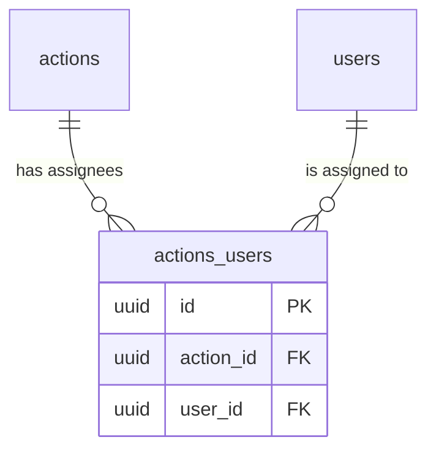
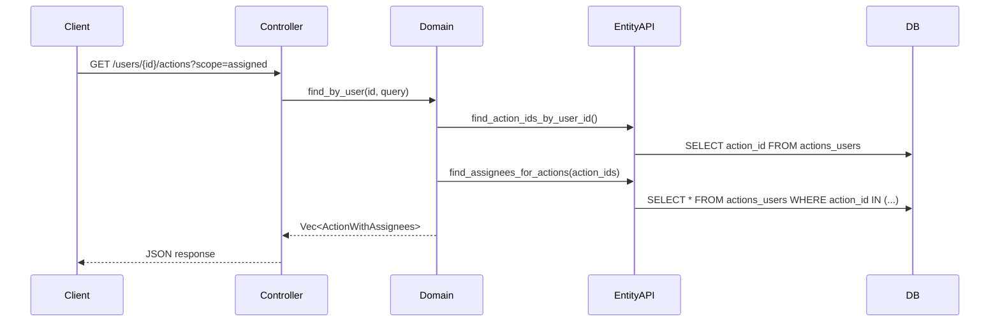

# Action Assignees

Actions can be assigned to one or more users (coach and/or coachee) via a many-to-many relationship.

## Data Model

## Layer Responsibilities

| Layer | Module | Responsibility |
|-------|--------|----------------|
| entity | `actions_users` | SeaORM entity definition |
| entity_api | `actions_user` | CRUD operations, batch queries |
| domain | `action` | `ActionWithAssignees` struct, `find_by_user()` |
| web | `action_controller` | Unified `/users/{id}/actions` endpoint |

## Key Functions

**entity_api** (`entity_api/src/actions_user.rs`):
- `set_assignees(db, action_id, user_ids)` - Atomically replaces all assignees (uses transaction)
- `find_assignees_for_actions(db, action_ids)` - Batch fetches assignees to avoid N+1 queries

**domain** (`domain/src/action.rs`):
- `find_by_user(db, user_id, query)` - Unified query with scope (assigned vs sessions) and filters

## Query Flow

## Filtering by assignee

The organization action lists (`GET /organizations/{org}/coaching_relationships/{id}/actions`
and the batch `GET /organizations/{org}/coaching_relationships/actions`) and
`GET /organizations/{org}/coaching_relationships/{id}/goal_progress` take
`assignee=coach|coachee|<user id>`. `coach` and `coachee` name a seat, so they resolve to the
relationship's `coach_id` or `coachee_id` (`AssigneeScope::user_id_in`).

A colleague relationship's seats hold the same role (`Kind::seats_differ` is false), so
`coach` and `coachee` name no one there:

- The single-relationship routes refuse them with a 422, `details.reason`
  `assignee_scope_not_applicable` (`domain::action::assignee_user_id`). A user id or no
  `assignee` works as for any relationship.
- The batch leaves colleague relationships out of a `coach` or `coachee` result and never
  refuses for them. Without `assignee`, or with a user id, they are included.
- The batch's 403 `forbidden_assignee_scope`, for a caller limited to their own and unassigned
  actions, is decided only over the relationships the scope applies to. A coachee who is also
  a colleague elsewhere still gets the 403 for `coach`; a caller whose relationships are all
  colleague ones gets an empty result.
