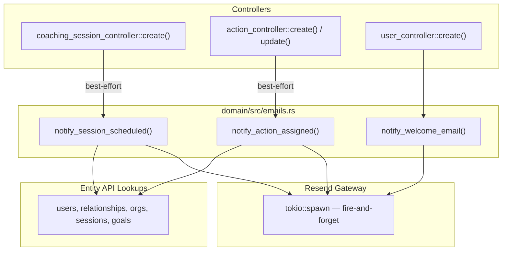

# Email Notifications Architecture

Transactional emails are sent via [Resend](https://resend.com/). Most still use Resend-hosted templates filled with variables; the single-session cancellation is composed in the backend from in-repo templates and written to the [email outbox](email_outbox.md) in the transaction that deletes the session (see [Email composition](email_composition.md)). The rest move the same way, one sender at a time. The backend handles all email logic; the frontend has no involvement.

## Notification Types

| Notification | Trigger | Recipients |
|---|---|---|
| Welcome | User created | New user |
| Session Scheduled | Coaching session created | Coach + coachee |
| Session Reminder | Periodic sweep, 24h before the session starts | Coachee |
| Session Rescheduled | Periodic sweep, once a single session's edited schedule settles | Coach + coachee |
| Action Assigned | Action created/updated with assignees | All assignees |

Every email about a coaching relationship (sessions, series, reminders, reschedules, action assignments) goes only to participants who are still members of the relationship's organization; resending an invite to a participant who is no longer a member is refused with a 409 (`details.reason` = `participant_not_a_member`). Cancellations go to both participants regardless of membership, so a removed member's calendar is cleaned up.

## Two-Tier Pattern

All email logic lives in `domain/src/emails.rs`, organized into two tiers:

**Tier 1 — `notify_*` orchestration (public).** Controllers call these. They look up any additional data needed via `entity_api`, then delegate to a private `send_*` function.

**Tier 2 — `send_*` construction (private).** Pure email senders. They take all data as parameters, build a `SendEmailRequest` with template variables, and fire via `gateway::resend::Client::send_email()`.

## Error Handling

All email sending is **best-effort** — failures never block the primary operation.

- **Session scheduled / action assigned**: Controllers use `if let Err(e) = ... { warn!(...) }`
- **Welcome email**: Uses `?` propagation for config errors (missing API key/template ID is a deployment issue worth surfacing). HTTP delivery is still fire-and-forget via `tokio::spawn()`.

## EmailNotification Trait

Encapsulates config resolution so `send_*` functions don't leak config details to controllers.

| Implementor | Env Var |
|---|---|
| `SessionScheduled` | `SESSION_SCHEDULED_EMAIL_TEMPLATE_ID` |
| `RecurringSessionsScheduled` | `RECURRING_SESSIONS_SCHEDULED_EMAIL_TEMPLATE_ID` |
| `SessionRescheduled` | `SESSION_RESCHEDULED_EMAIL_TEMPLATE_ID` |
| `RecurringSessionsRescheduled` | `RECURRING_SESSIONS_RESCHEDULED_EMAIL_TEMPLATE_ID` |
| `RecurringSessionsCancelled` | `RECURRING_SESSIONS_CANCELLED_EMAIL_TEMPLATE_ID` |
| `ActionAssigned` | `ACTION_ASSIGNED_EMAIL_TEMPLATE_ID` |
| `AddedToOrganization` | `ADDED_TO_ORGANIZATION_EMAIL_TEMPLATE_ID` |
| `SessionReminder` | `SESSION_REMINDER_EMAIL_TEMPLATE_ID` |

`RecurringSessionsCancelled` deliberately keeps the trait's `None` URL template: the
record is deleted by the time a recipient could click through, so the email carries no link.
The composed single-session cancellation carries no link for the same reason.

## Calendar Invites (`.ics`)

Session and series lifecycle emails carry an `invite.ics` attachment, base64-inlined via Resend with content type `text/calendar; method=REQUEST|CANCEL; charset=UTF-8`. One builder (`domain/src/gateway/ical.rs`) serves every flow and is pure: `dtstamp` is injected rather than read from the clock, so output is deterministic and unit-testable.

`UID` is stable per session (`<session_id>@myrefactor.com`) or per series (`<series_id>@myrefactor.com`), and `SEQUENCE` increments on every change. That pair is what lets a calendar client update or remove an existing event in place instead of accumulating duplicates. The `ical_sequence` columns on `coaching_sessions` and `coaching_session_series` persist the counter; cancellations bump it in memory only, since the row is being deleted in the same operation.

The anchor timezone is the schedule owner's `users.timezone` (the coach for a coaching relationship; for colleagues, whoever scheduled the session or series), with a real IANA `VTIMEZONE` block spliced in so strict clients render local time rather than floating time. When the zone is UTC or unrecognized, times are emitted as UTC with no `TZID`.

A series keeps the zone it was published in (`rule.timezone`). A save that keeps the stored start, recurrence and duration, for the whole series or for "this and following", changes nothing and keeps that zone, whoever saves it; this holds for coaching too, so a coach who has since changed timezone does not republish an unchanged series in the new zone. Any other change republishes in the schedule owner's zone as it is now.

Single sessions and series use separate templates for both reschedule and cancel. Resend templates have no conditional syntax, and the two paths supply different variables, so one template cannot render both shapes.

A series is a single recurring event with one `UID`, so rescheduling or cancelling one replaces or removes the whole event, including occurrences already in the past. Those sessions remain in the database; only the calendar view of them is lost.

## Session Reminders

Unlike every other notification here, the reminder has no triggering request. It is sent
by a periodic sweep (`domain::jobs::session_reminder`) that each tick claims the sessions
whose start has entered the lead window and emails the coachee. See
[Background Jobs](background_jobs.md) for the scheduler and the claim mechanism.

Three properties fall out of deriving "due" from the sessions table rather than from a
queue of pre-scheduled sends:

- A **rescheduled** session becomes due again on its own, because the claim stamp records
  the start it was sent for and no longer matches.
- A **cancelled** session simply stops being due — there is no orphaned job to cancel.
- A session **booked inside the lead window** is due immediately and reminded on the next
  tick, so a same-day booking still gets one heads-up.

The reminder goes to each participant the relationship's rules remind (`Rules::is_reminded`):
the coachee only for coaching, since the coach already holds the invite from the scheduled send;
both colleagues for a colleague relationship, each by their own notice and claim. It carries no `.ics` —
the calendar event was delivered when the session was scheduled, and re-sending the same
`UID`/`SEQUENCE` pair either does nothing or duplicates the event.

Template variables: `first_name`, `other_user_first_name`, `other_user_last_name`,
`other_user_role` (the other participant and what they are to the recipient: `coach` in a
coachee's reminder, `colleague` in a colleague's), `session_label` (`coaching session` for
coaching, `session` for colleagues), `session_label_plural` (`coaching sessions` or `sessions`),
`organization_name`, `session_date`,
`session_time`, `session_when`, `session_duration`, `session_url`, plus `session_title` and
`meeting_url` when the session has them (omitted rather than blanked, so the template's
`fallback_value` fires). The template should use the `other_user_*` names; see
[Renamed template variables](#renamed-template-variables) for the old `coach_*` ones.

Leaving `SESSION_REMINDER_EMAIL_TEMPLATE_ID` unset disables the job — nothing is
scheduled, rather than a job that logs a config error every few minutes.

## Renamed template variables

Resend templates live outside this repository, so a variable is renamed in three releases:
the backend sends the new name beside the old one, the template switches to the new name,
and a later release stops sending the old one. These old names are no longer sent:

| Template | Old variable, no longer sent | Use instead |
|---|---|---|
| Welcome | `coach_first_name` | `inviter_first_name` |
| Welcome | `coach_full_name` | `inviter_full_name` |
| Session Reminder | `coach_first_name` | `other_user_first_name` |
| Session Reminder | `coach_full_name` | `other_user_first_name` and `other_user_last_name`, with `other_user_role` for the role word |

Both welcome variables name whoever sent the invite, who may be an admin or a colleague
rather than a coach. The session, series and reminder templates name the other participant
by `other_user_role`, which is `colleague` in a colleague relationship, and name the session
by `session_label` (`Rules::session_label`): `coaching session`, or `session` for colleagues.
They also carry its plural, `session_label_plural` (`Rules::session_label_plural`):
`coaching sessions`, or `sessions` for colleagues.
The welcome template carries `session_label` alone, from the invitee's relationships in the
organization: their kind's label when all share one kind, or `session` when there are none
or both kinds.

The `.ics` DESCRIPTION has no template. One invite goes to both participants, so it names
the pair rather than "the other person": `Coach: {name}` for coaching, and
`Colleagues: {name} and {name}` when both seats hold the same role
(`Participants::description_line` in `domain/src/emails.rs`).

## Settled Reschedules

Editing a single session's date or duration (`PUT /coaching_sessions/{id}`) does not email
right away. It records a pending reschedule holding the schedule participants were last
told, and the `coaching-session-pending-reschedule` sweep (`domain::jobs::coaching_session_pending_reschedule`) sends the
session-rescheduled email once the schedule has been quiet for
`SESSION_RESCHEDULE_SETTLE_SECONDS` (default 60), once
`SESSION_RESCHEDULE_SETTLE_MAX_SECONDS` (default 300) have passed since the first
unannounced change, or as soon as the session starts within that cap.

- **Net change.** Several quick edits produce one email, moved from the last announced
  start to the current one. The `.ics` carries the session's current `ical_sequence`.
- **Undo sends nothing.** Moving the session back to its announced schedule before the
  email goes out drops the pending row, and nobody is emailed.
- **Retries.** A failed send is retried up to three times, then given up; the regular
  reminder is the fallback. A new change restores the full count, and a failure is not
  charged to a change made during the send. Delivery is at least once (see
  [Background Jobs](background_jobs.md)).
- **Members only.** Membership is checked at send time, as the reminder does: a
  participant removed from the organization during the wait is not emailed, and a change
  whose coachee was removed settles unsent.
- **No email configured.** Without `RESEND_API_KEY` or
  `SESSION_RESCHEDULED_EMAIL_TEMPLATE_ID` the sweep still runs and drops due rows unsent,
  since a pending row suppresses the session's reminder.

Every other session email stays immediate: creation, this-and-following edits, series
edits, cancellations, and resends. Once one of those reaches the coachee, the pending
reschedule is settled against the schedule that was sent, under the session's row lock:
it is dropped if the session still matches, otherwise the newer change stays pending,
now from what was sent.

### Invites re-sent after a relationship changes kind

A confirmed kind switch (or reversal) owes both participants a fresh invite for every upcoming
session and series of the relationship, so calendar text such as the `.ics` participant line
follows the new kind. The switch's transaction writes one `coaching_session_pending_invites`
row per invite (a series member's is its series', any other session's its own) and
participant; a second switch before the sweep owes nothing more (one row per target and
user). A switch landing while the sweep is sending a row releases that row's claim, so the
earlier send's completion leaves it owed and the newer text goes out too. The pending
reschedule sweep sends each row to that participant alone, through the same resend as
`POST .../resend_invite` (same `UID`, higher `SEQUENCE`), and deletes it once delivered. It
claims at most 10 rows a tick, and a failed send hands the rest of the tick's rows back
uncharged, so a large switch drains over several ticks rather than bursting Resend. A
participant who has left the organization, a session that has passed, and a series with
nothing left to attend are owed nothing; a failed read is retried, not taken for any of
those. A failed send is retried up to three times. Without `RESEND_API_KEY`, or without the
row's own template (session or recurring sessions scheduled), the row is dropped unsent.

## Timezone Handling

Session dates are stored as UTC. The `format_session_date_time()` helper converts to each recipient's timezone (from `users.timezone`, an IANA string) using `chrono-tz`, falling back to UTC if invalid.

## Environment Variables

| Variable | Description |
|---|---|
| `RESEND_API_KEY` | API authentication |
| `WELCOME_EMAIL_TEMPLATE_ID` | Welcome email template |
| `SESSION_SCHEDULED_EMAIL_TEMPLATE_ID` | Session scheduled template |
| `RECURRING_SESSIONS_SCHEDULED_EMAIL_TEMPLATE_ID` | Recurring Sessions scheduled template |
| `SESSION_RESCHEDULED_EMAIL_TEMPLATE_ID` | Single-session reschedule template |
| `RECURRING_SESSIONS_RESCHEDULED_EMAIL_TEMPLATE_ID` | Series reschedule template |
| `RECURRING_SESSIONS_CANCELLED_EMAIL_TEMPLATE_ID` | Series cancellation template |
| `ACTION_ASSIGNED_EMAIL_TEMPLATE_ID` | Action assigned template |
| `ADDED_TO_ORGANIZATION_EMAIL_TEMPLATE_ID` | Added-to-organization template |
| `SESSION_REMINDER_EMAIL_TEMPLATE_ID` | Upcoming-session reminder template. Unset disables the reminder job |
| `SESSION_REMINDER_LEAD_HOURS` | How far ahead of a session its reminder is sent (default: `24`) |
| `SESSION_REMINDER_POLL_MINUTES` | How often the reminder sweep runs (default: `15`) |
| `SESSION_RESCHEDULE_SETTLE_SECONDS` | How long a single session's schedule must be quiet before its reschedule is emailed (default: `60`, minimum `1`) |
| `SESSION_RESCHEDULE_SETTLE_MAX_SECONDS` | Longest a reschedule waits for its email after the first unannounced change (default: `300`, never below the settle period) |
| `FRONTEND_BASE_URL` | Base URL for email links (e.g. `https://app.myrefactor.com`), and for the composed emails' logo and privacy link |
| `SESSION_SCHEDULED_EMAIL_URL_PATH` | URL path template for session links (default: `/coaching-sessions/{session_id}`) |
| `ACTION_ASSIGNED_EMAIL_URL_PATH` | URL path template for action links (default: `/coaching-sessions/{session_id}?tab=actions`) |
| `ADDED_TO_ORGANIZATION_EMAIL_URL_PATH` | URL path for added-to-organization links, supports `{organization_id}` (default: `/dashboard`) |

## Key Files

| File | Role |
|---|---|
| `domain/src/emails.rs` | `notify_*` + `send_*` + `EmailNotification` trait; builds and enqueues the composed emails |
| `domain/src/email_composition/` | Composed emails: the `Email` trait, `compose`, the shared view pieces |
| `domain/src/gateway/resend.rs` | HTTP client, request builder, fire-and-forget delivery |
| `domain/src/jobs/session_reminder.rs` | The reminder sweep |
| `domain/src/jobs/coaching_session_pending_reschedule.rs` | The settled-reschedule sweep |
| `service/src/config.rs` | Template ID and URL config |
