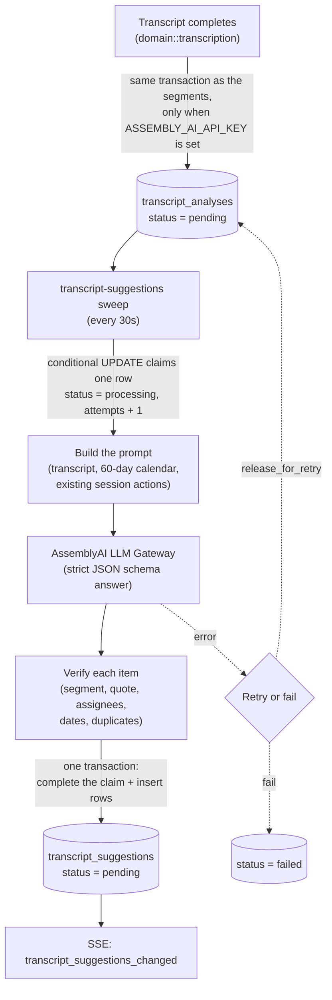

# Transcript Suggestions Architecture

When a coaching session transcript completes, the backend asks a language model which actions the coach and coachee committed to, and shows the answers as suggestions they review. Nothing becomes an Action until one of them accepts it. Only suggested Actions exist today; the design leaves room for other targets such as agreements and topics.

The work runs as a periodic sweep (see [background_jobs.md](background_jobs.md) for why), and it is off unless `ASSEMBLY_AI_API_KEY` is set.

## Flow

1. **Completion.** `persist_completion_with` stores the segments, marks the transcription completed, and inserts a pending analysis for each target, all in one transaction. A completed transcript therefore never lacks its analysis, and an analysis never exists for a transcript that did not complete. Transcripts that complete while no key is configured are never analyzed.
2. **Claim.** The sweep (`domain/src/jobs/transcript_suggestions.rs`) finds up to 5 claimable analyses, oldest first, and claims each with a single conditional `UPDATE`.
3. **Prompt.** `transcript_suggestion::prompt` renders the coach and coachee names, the session date, the next session date, a 60-day calendar, the session's existing actions (as `a1..aN`) and the transcript lines (as `s1..sN`, each with a timestamp and a coach, coachee or raw speaker label). The model refers to lines and actions by these short refs, never by id. The instructions are in `actions_prompt.md`.
4. **Model call.** `gateway::assembly_ai::llm_gateway` posts to `{base_url}/chat/completions` with a strict `json_schema` response format, a 10 second connect timeout and a 180 second request timeout. The model defaults to `claude-sonnet-4-6`.
5. **Verification.** See [Verification](#verification).
6. **Store.** One transaction completes the claim (recording model and token counts) and inserts the suggestion rows. Token cost is recorded afterwards when a pricing row exists.
7. **Notify.** When an analysis ends, completed (with or without suggestions) or failed for good, `DomainEvent::TranscriptSuggestionsChanged` goes to the session's coach and coachee, so an open page refetches its suggestions and scan state. Delivery is ephemeral like every SSE event.

A transcript with no segments completes its analysis with model `none` and no suggestions, without calling the model.

## Data model

Two tables; see `docs/db/refactor_platform_rs.dbml`.

**`transcript_analyses`** is one model run per `(transcription_id, target)` (unique). It holds the run state: `status` (`pending`, `processing`, `completed`, `failed`), `attempts`, `claimed_at`, `error_message`, and on success the `model` and `input_tokens` / `output_tokens`. It cascades with the transcription.

**`transcript_suggestions`** is one row per proposed item. It cascades with the session, the analysis and the source segment.

| Column | Meaning |
|---|---|
| `proposal` (JSONB) | What accept will create. For actions: the action fields (`body`, `due_by`, `status`), `assignee_ids`, and `due_phrase`, the spoken deadline kept so the reviewer can see it. Editing rewrites this value. |
| `segment_id`, `quote` | The transcript line it came from and words from that line. |
| `duplicate_of_id` | An existing item of the same target the model judged to be the same commitment. |
| `status` | `pending`, `accepted`, `dismissed`. |
| `resolved_by`, `resolved_at` | Who accepted or dismissed it, and when. `resolved_by` is set null if the user is deleted. |
| `created_entity_id` | The entity created on accept. |

`duplicate_of_id` and `created_entity_id` have no foreign key because they point at the target's own table, which differs per target (`actions` today). A foreign key to a single table would not fit a second target, and a deleted action should leave the suggestion readable: a missing duplicate is simply not shown.

### Extension point

`Target` (`transcript_suggestion_target`, currently only `action`) names the kind of suggestion. The `Suggestible` trait is what a new kind implements:

- `TARGET`, the `Candidate` type the model returns and the `Proposal` type stored;
- `instructions()`, `schema_name()` and `output_schema()` for the prompt and the strict answer schema;
- `verify`, which turns a candidate into a stored proposal or drops it;
- `assignees` and `check`, which the review layer uses for permission and edit validation.

`Actions` is the one implementation. `extract::run::<S>` and `verify_output::<S>` are generic over it, so adding agreements or topics means a new `Target` variant (with a migration for the enum value) and a new `Suggestible` implementation, with the sweep dispatching on `analysis.target`.

## Reliability

Constants live in `domain/src/jobs/transcript_suggestions.rs`.

| Setting | Value |
|---|---|
| Tick | 30 seconds, first run immediately |
| Analyses per tick | 5 |
| Stale claim cutoff | 10 minutes |
| Attempts before failing | 3 |

- **Claim.** An analysis is claimable when it is `pending`, or `processing` with a `claimed_at` older than 10 minutes, and has fewer than 3 attempts. The claim sets `processing`, stamps `claimed_at` with the time of that claim (not the start of the tick, so earlier model calls in the same tick never make it look stale) and increments `attempts` in one `UPDATE ... RETURNING`, so replicas divide the work and a crashed worker's claim is retaken once stale.
- **Superseded workers.** Completing, releasing and failing a run are all conditional on the row still being `processing` with the same `attempts` the worker was given. A worker whose claim went stale and was retaken sees a different count and changes nothing: a completion stores nothing, rolls back and reports `Superseded`, and a late failure is logged and dropped, so it can never return another worker's completed analysis to `pending` or `failed`.
- **Which errors retry.** Network, timeout, rate limit, provider (including a truncated answer), deserialization, and a model answer with no suggestions list all release the row back to `pending` with the error kind, until the third attempt. Authentication and configuration errors from the gateway (401, 403, 400, 422) fail immediately, as does a transcription that no longer exists, since retrying cannot help. A database error while loading or storing is retried.
- **Failure record.** `error_message` holds only the error's kind (for example `provider error: Network`), never provider or model text.
- **Cost.** `cost::record_llm_tokens` writes a `platform_cost_metrics` row from the current `cost_pricing_config` rate for provider `llm_gateway`, metric `llm_tokens`. With no pricing row it logs a warning and skips; a failure to record cost never fails the analysis.

## Verification

The model's answer is untrusted. Each item is checked independently by `Actions::verify`; one bad item never discards the others. At most 50 verified suggestions are kept from one answer, as a backstop against a runaway answer; when more arrive, the first 50 in answer order are kept and a warning logs how many were dropped (counts only, no text).

| Condition | Result |
|---|---|
| Item does not match the answer schema | Dropped |
| Body empty, or longer than 2000 characters | Dropped |
| `source_segment` is not a ref of a real transcript line | Dropped |
| Quote is not found in the source line (ignoring case and whitespace) | Kept; the quote falls back to the line's own text, first 200 characters |
| Assignees | `coach` and `coachee` map to the session's two people, repeats removed; an empty list is kept |
| Due phrase empty or over 200 characters | Cleared (no phrase) |
| Due date not a valid `YYYY-MM-DD` | Cleared |
| Due date outside the session date through 365 days after it | Cleared |
| `duplicate_of` is not a ref of an existing action | Cleared (not flagged) |

### Due dates

The model is asked for a date, but dates are settled by `due_date::reconcile`, which resolves the spoken `due_phrase` deterministically against the session date (in the coach's timezone) and the next session date:

- A **recognized** phrase overrides the model's date. Recognized forms include today, tonight, EOD, tomorrow, weekday names (the first such day after the session), `next <weekday>` when it is unambiguous, end of the week and "this week" (the last day of the coach's week, Friday by default; the session details tell the model that day too), the weekend (that Sunday), end of the month, `in N days|weeks`, `N weeks from <anchor>`, `<month> <day>`, `M/D`, and "next session" or "next time" when a next session exists. Filler such as "by", "before" or "no later than" is ignored.
- An **ambiguous** phrase blanks the date: "soon", "ASAP", "next week", "at some point", `next <weekday>` said earlier in the same week, and "next time" when no next session exists.
- An **unrecognized** phrase keeps the model's date, if it is within bounds.

A resolved date is stored as noon in the coach's timezone so the day holds for viewers elsewhere. Two exceptions keep a deadline from landing mid-meeting: a date on the session's own day is due at 23:59 that day, so "after our call" never falls before the session; and a phrase naming the next session is due when that session starts.

## Review

Routes are under `/coaching_sessions/:id/transcript_suggestions`: list (pending by default, or dismissed; oldest first), and `POST` accept, dismiss and restore. Access first goes through `CoachingSessionAccess`, and `TranscriptSuggestionAccess` also requires the suggestion to belong to the path session (otherwise 404).

- **Who may act.** Only the session's coach and coachee. The coach may act on anything. The coachee may not act on a coach-only suggestion, and may not add or remove the coach from the assignees in an edited accept. Violations are 403.
- **Accept.** Creates one Action owned by the accepting user, with the stored body, due date, goal and assignees, or with the edits sent in the request body. Edits replace `body`, `due_by`, `goal_id` and `assignee_ids`; assignees must be the coach or coachee, the body 1 to 2000 characters, and the goal in the session's relationship (422 otherwise). The stored suggestion itself is never edited. The action insert and the `pending` to `accepted` transition commit in one transaction; a second accept finds the row no longer pending, rolls back and returns 409. The transition also refuses a row whose `created_entity_id` is already set, so one suggestion never creates two actions, even after its status is changed by hand.
- **Linked rows count as accepted.** A row with `created_entity_id` set is never listed as pending or dismissed, whatever its status says. Assignment emails and the action SSE event follow the normal Action path.
- **Dismiss and restore** move between `pending` and `dismissed`; the wrong starting state is a 409.
- **Default due date.** A suggestion with no due date shows, and on accept receives, the start of the next session if it is still in the future. Otherwise it is 7 days after the session when the session has not started yet (source `week_after_session`), or 7 days from now (`seven_days`), so it never falls before the session or in the past. The list response carries it as `default_due` with its source.
- **Why a spoken deadline has no date.** When a suggestion has a `due_phrase` but no `due_by`, the list says why in `undated_reason`: `no_next_session` for a phrase naming the next session while none is scheduled, `not_a_date` for a vague or ambiguous one ("soon", "next week"). Once a next session is scheduled, a next-session phrase has no reason, since the default is then that session. It is computed at read and at accept, not stored, so it follows the schedule.
- **Duplicates.** A suggestion flagged as a duplicate is still listed, with the existing action's text, for the reviewer to dismiss or accept.

## Privacy

- **Sent to AssemblyAI and the model vendor:** the coach and coachee names, session and next-session dates, a calendar, the text of the session's existing actions (truncated to 300 characters each), and the full speaker-labelled transcript.
- **Logged:** analysis ids, attempt counts, request id, model, token counts, HTTP status codes, and error kinds. Transcript text, prompts, model output and provider error bodies are never logged or stored in `error_message`.
- **Stored:** the verified suggestions and, for each, a quote from the transcript.

The account-side controls (training opt-out, retention TTL, provider choice) are in the "Suggested Actions: private AssemblyAI setup" checklist in [docs/setup.md](../setup.md).
